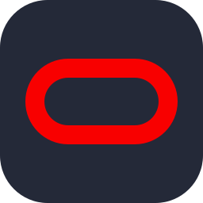

  

  
  
  
  
  

 

Sou estudante de **Análise e Desenvolvimento de Sistemas** no **IFSP** e trabalho como **Assistente de TI**. Comecei no suporte e hoje também desenvolvo sistemas internos que estão em uso na empresa. Meu foco é o **back-end**: entender o que acontece entre a requisição e a resposta.

- 🔭 Construindo **APIs REST com Node.js e TypeScript**
- 📚 Estudando **Java EE** com a Red Hat (EJB, JPA, JAX-RS)
- 💬 Pode falar comigo sobre **back-end, bancos de dados e APIs**
- ⚡ Curto entender o *porquê* das coisas, não só o *como*

 

<table>
  <tr>
    <td width="25%" valign="top">
      <code>01</code> <b>Back-end</b>  
       <b>Node.js</b> CRM · PrintMonitor · Concessionária  
       <b>PHP</b> CRM · PrintMonitor  
       <b>TypeScript</b> PrintMonitor · Concessionária  
       <b>Java</b> Sistema de Compras
    </td>
    <td width="25%" valign="top">
      <code>02</code> <b>Banco de dados</b>  
       <b>MySQL</b> Concessionária  
      🔥 <b>Firebird</b> CRM · PrintMonitor  
       <b>Oracle</b> faculdade
    </td>
    <td width="25%" valign="top">
      <code>03</code> <b>Front-end</b>  
       <b>React</b> CRM · PrintMonitor  
       <b>Angular</b> portfólio  
       <b>JS · HTML · CSS</b> base de tudo
    </td>
    <td width="25%" valign="top">
      <code>04</code> <b>Ferramentas</b>  
       <b>Git</b> todos os projetos  
       <b>Postman</b> teste de APIs  
       <b>IntelliJ IDEA</b> projetos Java
    </td>
  </tr>
</table>

 

<table>
  <tr>
    <td width="50%"></td>
    <td width="50%"></td>
  </tr>
  <tr>
    <td width="50%"></td>
    <td width="50%"></td>
  </tr>
</table>

Os sistemas de uso interno não têm código público. Os detalhes estão no <a href="https://gustavo-domingos.vercel.app/#projetos">portfólio</a>.

  

 

  
  

  

 

Aberto a trocar ideias, colaborar em projetos ou conversar sobre back-end. O jeito mais rápido é o formulário do portfólio, que manda a mensagem direto para o meu e-mail.

  
  
  

 

<code>gusta.dev</code> · feito com muito energético e curiosidade em Boituva/SP

